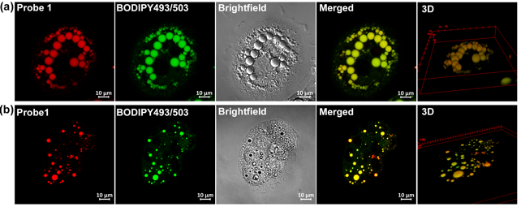
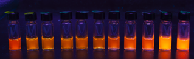
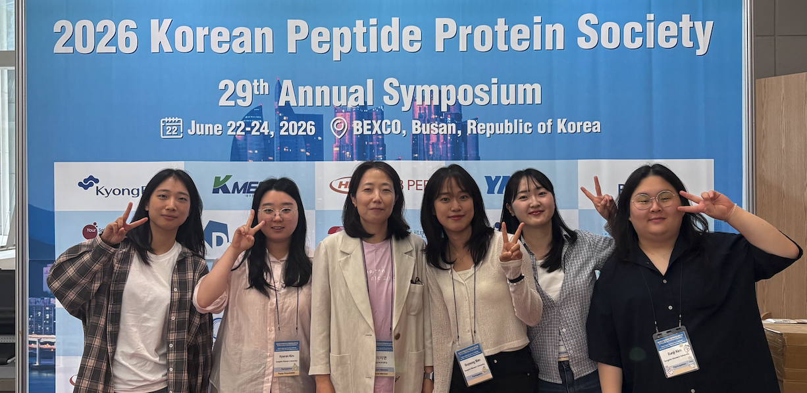

```{=html}
<style id="home-page-styles">

#quarto-content.quarto-container{display:block!important;width:100%;max-width:none;margin:0!important;padding:0!important;}
#quarto-document-content.content{display:block;width:100%;max-width:none!important;margin:0!important;padding:0!important;}
#title-block-header{display:none;}
.home-page h1,.home-page h2,.home-page h3{padding-bottom:0;}
.home-page p{font-size:inherit;line-height:inherit;}

.home-page{--ink:#142b3b;--muted:#566e7c;--navy:#102b3b;--teal:#16766e;--mint:#b2dfce;--gold:#c6a569;--line:#dae4e6;color:var(--ink);font:16px/1.75 Arial,Helvetica,sans-serif;overflow:hidden;background:#fff}
.home-page *{box-sizing:border-box}.home-page a{color:inherit;text-decoration:none}.home-page a:hover{text-decoration:underline;text-underline-offset:4px}.home-page a:focus-visible{outline:3px solid #39a899;outline-offset:5px}.home-page h1,.home-page h2,.home-page h3,.home-page p,.home-page figure{margin:0;padding-bottom:0}.home-page .wrap{width:min(1160px,calc(100% - 80px));margin:auto}.home-page .eyebrow{font-size:10px;letter-spacing:2px;text-transform:uppercase;font-weight:700}.home-page .quiet{color:var(--muted)}
.home-page .hero{background:var(--navy);color:#fff;position:relative;isolation:isolate}.home-page .hero:before{content:'';position:absolute;inset:0;z-index:-1;background:radial-gradient(ellipse at 80% 44%,#3b717d36,transparent 58%)}.home-page .hero-inner{display:grid;grid-template-columns:1.1fr 1fr;gap:40px;align-items:center;padding:72px 0 52px}.home-page .hero .eyebrow{color:#99c2c3;margin-bottom:24px}.home-page h1{font-family:Georgia,'Times New Roman',serif;font-size:clamp(48px,5.1vw,72px);font-weight:400;line-height:1.08;letter-spacing:-2.5px;border:0!important;max-width:650px}.home-page h1 em{color:var(--mint);font-weight:400}.home-page .hero p{color:#c1d4da;font-size:16px;line-height:1.85;max-width:475px;margin-top:24px}.home-page .hero-actions{display:flex;gap:14px;flex-wrap:wrap;margin-top:30px}.home-page .button{display:inline-flex;align-items:center;gap:22px;justify-content:space-between;padding:12px 20px;border:1px solid #b8cdd1;font-size:12px;font-weight:600;white-space:nowrap;line-height:1.8;transition:background .15s,color .15s}.home-page .button.primary{background:#b2dfce;color:#173c3d;border-color:#b2dfce}.home-page .button.secondary{border-color:#6c8c98;color:#e0edee}.home-page .button:hover{background:#e5f4ed;color:#173c3d;text-decoration:none}.home-page .hero-location{font-size:10px;letter-spacing:.5px;color:#7fa4af;margin-top:31px;display:flex;gap:9px;align-items:center}.home-page .hero-location:before{content:'';width:6px;height:6px;border:1px solid #8cafb9;border-radius:50%}
.home-page .visual{position:relative;padding:30px 0 30px 26px;min-width:0}.home-page .visual:before{content:'';position:absolute;width:360px;height:360px;border:1px solid #6d9aa133;border-radius:50%;left:45px;top:15px;z-index:-1}.home-page .visual:after{content:'';position:absolute;width:410px;height:410px;border:1px dashed #6d9aa128;border-radius:50%;left:20px;top:-10px;z-index:-1}.home-page .visual-top{display:flex;justify-content:space-between;align-items:center;margin:0 0 12px 0;font:9px/1.6 Arial,sans-serif;letter-spacing:1.6px;color:#94b6bd;text-transform:uppercase}.home-page .visual-top span:last-child{color:#c5af83}.home-page .image-frame{border:1px solid #54757d;background:#071114;padding:12px 12px 10px;box-shadow:0 20px 40px #020d1622;transform:rotate(-2deg)}.home-page .image-frame img{width:100%;height:auto;display:block}.home-page .image-frame figcaption{display:flex;justify-content:space-between;margin-top:9px;font:9px/1.6 Arial,sans-serif;color:#a1b6ba;letter-spacing:.4px}.home-page .vials{position:relative;width:78%;margin:24px 0 0 auto;padding:10px 11px 8px;background:#071115;border:1px solid #516d76;transform:rotate(2deg);box-shadow:0 14px 30px #020d1638}.home-page .vials img{width:100%;height:auto;display:block}.home-page .vials figcaption{font:9px/1.5 Arial,sans-serif;letter-spacing:.5px;color:#9db9c0;margin-top:8px}.home-page .visual-label{position:absolute;left:0;bottom:52px;font-family:Georgia,serif;font-style:italic;color:#9cc7c5;font-size:15px;line-height:1.6;max-width:100px}.home-page .hero-bottom{padding:18px 0;border-top:1px solid #41606c;display:flex;align-items:center;justify-content:space-between;gap:20px;font-size:10px;letter-spacing:.8px;color:#9dbac3}.home-page .hero-bottom b{font-weight:500;color:#d5e7e9}.home-page .hero-bottom .keywords{display:flex;gap:23px}.home-page .hero-bottom .keywords span{position:relative}.home-page .hero-bottom .keywords span+span:before{content:'';position:absolute;left:-12px;top:8px;width:2px;height:2px;border-radius:50%;background:#8caeaf}
.home-page .section-top{display:flex;align-items:end;justify-content:space-between;gap:30px;margin-bottom:30px}.home-page .section-top .eyebrow{color:#6f8a97;margin-bottom:13px}.home-page h2{font-family:Georgia,serif;font-size:35px;line-height:1.25;font-weight:400;letter-spacing:-.7px;border:0}.home-page .text-link{font-size:12px;font-weight:600;white-space:nowrap;display:inline-block}.home-page .text-link span{margin-left:12px;font-weight:400}.home-page .science{padding:66px 0 64px}.home-page .science-intro{display:grid;grid-template-columns:1fr 1fr;gap:55px;align-items:end;margin-bottom:38px}.home-page .science-intro .eyebrow{color:var(--teal);margin-bottom:14px}.home-page .science-intro p{font-size:14px;color:var(--muted);line-height:1.9;max-width:500px}.home-page .areas{display:grid;grid-template-columns:repeat(3,1fr);gap:25px}.home-page .area-card{position:relative;display:flex;flex-direction:column;align-items:start;border:1px solid var(--line);padding:25px 26px 26px;transition:transform .15s,background .15s;color:var(--ink);background:#fff;min-width:0}.home-page .area-card:hover{background:#f4f9f6;transform:translateY(-3px);text-decoration:none}.home-page .card-top{display:flex;align-items:center;justify-content:space-between;width:100%;color:#7d959e;margin-bottom:18px;font:11px monospace;letter-spacing:1px}.home-page .card-top svg{width:68px;height:42px;color:#547f98}.home-page .area-card:nth-child(2) .card-top svg{color:#3b8b79}.home-page .area-card:nth-child(3) .card-top svg{color:#af8a4e}.home-page .area-card h3{font-family:Georgia,serif;font-weight:400;font-size:24px;line-height:1.35;letter-spacing:-.4px;max-width:280px;border:0}.home-page .area-card p{font-size:12px;color:var(--muted);line-height:1.9;margin-top:16px;margin-bottom:22px}.home-page .card-bottom{margin-top:auto;display:flex;align-items:center;justify-content:space-between;width:100%;font-size:10px;color:#496a77;font-weight:600;letter-spacing:.3px}.home-page .card-bottom span:last-child{font-size:18px;color:#6f959d}
.home-page .news{padding:48px 0 55px;border-top:1px solid var(--line);background:#f5f8f7;scroll-margin-top:80px}.home-page .news .section-top{margin-bottom:12px}.home-page #lab-updates{margin:0}.home-page .news-list{display:grid;grid-template-columns:repeat(2,minmax(0,1fr));gap:38px}.home-page .update-item{position:relative;padding:23px 0 0!important;margin:0!important;border-top:1px solid #cddcda;line-height:1.75}.home-page .update-item:before,.home-page .update-item:after,.home-page .update-item>div{display:none!important}.home-page .update-item>span{display:block!important}.home-page .update-item>span:first-of-type{font-family:monospace!important;font-size:11px!important;letter-spacing:1px;color:#648279;font-weight:400!important;margin-bottom:13px!important}.home-page .update-item>span:nth-of-type(2){font-size:17px!important;font-weight:600!important;line-height:1.7;margin-bottom:10px!important;color:#1a403e}.home-page .update-item>span:nth-of-type(3){font-size:12px!important;line-height:1.95;color:#5a726f!important;max-width:510px}.home-page .update-item em{font-style:italic}.home-page #no-recent-news{color:#5a726f;font-size:13px}
.home-page .publication{padding:65px 0 70px}.home-page .publication-panel{display:grid;grid-template-columns:.92fr 1.12fr;gap:56px;align-items:center;border:1px solid var(--line);background:#fff}.home-page .paper-art{background:#f3f3eb;align-self:stretch;display:flex;flex-direction:column;justify-content:center;min-width:0;position:relative;padding:20px 18px 16px;overflow:hidden}.home-page .paper-art svg{width:100%;height:auto;display:block}.home-page .paper-art figcaption{font-size:9px;color:#859285;padding:0 20px 6px;line-height:1.6}.home-page .paper-copy{padding:35px 32px 35px 0}.home-page .paper-copy .eyebrow{color:#698271;margin-bottom:14px;font-size:9px}.home-page .paper-copy h3{font-family:Georgia,serif;font-size:28px;font-weight:400;line-height:1.35;letter-spacing:-.4px;border:0}.home-page .paper-copy p{font-size:13px;line-height:1.85;color:var(--muted);margin-top:17px}.home-page .paper-copy .citation{margin-top:19px;color:#517268;font-size:11px;line-height:1.7}.home-page .paper-copy .text-link{color:var(--teal);margin-top:17px;font-size:11px}
.home-page .people{background:#102b3b;color:#fff}.home-page .people-inner{display:grid;grid-template-columns:1.1fr 1fr;align-items:stretch}.home-page .group-photo{position:relative;min-width:0}.home-page .group-photo img{width:100%;height:100%;min-height:380px;object-fit:cover;object-position:center 35%;display:block;max-width:100%}.home-page .group-photo figcaption{position:absolute;bottom:0;left:0;right:0;background:linear-gradient(transparent,#0c202be0);padding:32px 20px 14px;color:#e5eceb;font-size:10px;letter-spacing:.2px}.home-page .people-copy{padding:48px 42px 42px;align-self:center}.home-page .people-copy .eyebrow{color:#91bab7;margin-bottom:19px}.home-page .people-copy h2{font-size:34px;line-height:1.3;color:#fff}.home-page .people-copy p{font-size:13px;line-height:1.9;color:#afcbd0;margin-top:20px}.home-page .people-copy .hero-actions{margin-top:23px}.home-page .people-copy .button{font-size:11px;padding:10px 15px;gap:18px}.home-page .people-copy .text-link{color:#cadfe3;font-size:11px;align-self:center}.home-page .people-copy .contact{padding-top:20px;margin-top:25px;border-top:1px solid #385967;font-size:10px;color:#8eb1bd;letter-spacing:.3px}.home-page .people-copy .contact a{color:#b1d2d5}
.home-page .closing{padding:33px 0;display:flex;align-items:center;justify-content:space-between;gap:30px}.home-page .closing p{font-family:Georgia,serif;font-size:20px;line-height:1.5;color:#48636a}.home-page .closing a{font-size:11px;color:#5e7b83}.home-page .closing a span{margin-left:14px}
@media(max-width:950px){.home-page .wrap{width:calc(100% - 48px)}.home-page .hero-inner{gap:20px;padding:52px 0 42px}.home-page h1{font-size:54px}.home-page .visual{padding-left:12px}.home-page .visual-label{display:none}.home-page .visual:before,.home-page .visual:after{width:280px;height:280px;left:0}.home-page .area-card{padding:20px}.home-page .area-card h3{font-size:21px}.home-page .publication-panel{gap:30px}.home-page .paper-copy h3{font-size:25px}.home-page .people-copy{padding:35px 30px}.home-page .people-copy h2{font-size:29px}.home-page .hero-bottom .keywords{gap:16px}}
@media(max-width:650px){.home-page .wrap{width:calc(100% - 36px)}.home-page .hero-inner{grid-template-columns:1fr;gap:22px;padding:40px 0 24px}.home-page .hero .eyebrow{font-size:9px;letter-spacing:1.6px;margin-bottom:22px}.home-page h1{font-size:49px;letter-spacing:-1.8px;line-height:1.12}.home-page .hero p{font-size:14px;margin-top:21px;line-height:1.8}.home-page .hero-actions{gap:10px;margin-top:24px}.home-page .button{padding:10px 16px;font-size:11px;gap:15px}.home-page .hero-location{margin-top:22px;font-size:9px}.home-page .visual{padding:20px 4px 10px;max-width:440px;width:100%;margin:auto}.home-page .visual:before,.home-page .visual:after{width:270px;height:270px;left:25px;top:0}.home-page .vials{width:73%;margin-top:18px}.home-page .visual-top{font-size:8px}.home-page .image-frame{padding:8px}.home-page .image-frame figcaption{font-size:8px}.home-page .vials figcaption{font-size:8px}.home-page .hero-bottom{display:block;padding:16px 0;font-size:9px}.home-page .hero-bottom .keywords{margin-top:9px;gap:22px;font-size:9px}.home-page .science{padding:38px 0 40px}.home-page .science-intro{grid-template-columns:1fr;gap:18px;margin-bottom:25px}.home-page h2{font-size:29px;line-height:1.3}.home-page .science-intro p{font-size:13px}.home-page .areas{grid-template-columns:1fr;gap:13px}.home-page .area-card{padding:21px 23px}.home-page .card-top{margin-bottom:10px}.home-page .area-card h3{font-size:25px;max-width:none}.home-page .area-card p{margin:12px 0 16px;font-size:12px}.home-page .card-top svg{height:34px}.home-page .section-top{align-items:center;gap:15px}.home-page .text-link{font-size:10px}.home-page .news{padding:35px 0 38px}.home-page .news-list{grid-template-columns:1fr;gap:26px}.home-page .update-item{padding-top:20px!important}.home-page .update-item>span:nth-of-type(2){font-size:16px!important}.home-page .update-item>span:nth-of-type(3){font-size:12px!important}.home-page .publication{padding:38px 0 40px}.home-page .publication-panel{grid-template-columns:1fr;gap:0}.home-page .paper-art{padding:15px 15px 10px}.home-page .paper-art svg{max-height:240px}.home-page .paper-copy{padding:25px}.home-page .paper-copy h3{font-size:26px}.home-page .people-inner{grid-template-columns:1fr}.home-page .group-photo img{min-height:0;height:260px}.home-page .people-copy{padding:30px 25px 32px}.home-page .people-copy h2{font-size:31px}.home-page .people-copy p{font-size:13px}.home-page .people-copy .eyebrow{margin-bottom:14px}.home-page .closing{display:block;padding:28px 0}.home-page .closing p{font-size:19px}.home-page .closing a{display:inline-block;margin-top:14px}}
@media(prefers-reduced-motion:reduce){.home-page .area-card,.home-page .button{transition:none}.home-page .area-card:hover{transform:none}}

/* Compact opening section; shared with the Research page's visual rhythm. */
.home-page .hero-inner{padding:34px 0 28px;gap:34px;}
.home-page h1{font-size:clamp(44px,4.35vw,60px);letter-spacing:-1.8px;}
.home-page .hero p{font-size:15px;margin-top:19px;line-height:1.8;}
.home-page .hero-actions{margin-top:22px;}
.home-page .visual{width:100%;max-width:440px;margin-left:auto;padding:12px 0 55px;}
.home-page .visual:before{width:280px;height:280px;left:70px;top:-5px;}
.home-page .visual:after{width:320px;height:320px;left:48px;top:-24px;}
.home-page .visual-top{margin-bottom:9px;font-size:8px;}
.home-page .image-frame{padding:8px 8px 7px;}
.home-page .image-frame figcaption{margin-top:6px;font-size:8px;}
.home-page .vials{position:absolute;right:0;bottom:0;width:58%;margin:0;padding:6px 7px;}
.home-page .vials figcaption{font-size:8px;margin-top:4px;}
.home-page .visual-label{display:none;}
.home-page .hero-bottom{padding:13px 0;}
.home-page .news{border-top:0;}
.home-page .science{padding:48px 0 54px;}
.home-page .group-photo{align-self:center;}
.home-page .group-photo img{height:auto;min-height:0;object-fit:contain;}
@media(max-width:950px){.home-page .hero-inner{gap:24px;padding:30px 0 25px}.home-page h1{font-size:49px}.home-page .visual-top{letter-spacing:1px}.home-page .vials{width:62%}}
@media(max-width:650px){.home-page .hero-inner{padding:29px 0 20px;gap:14px}.home-page h1{font-size:46px}.home-page .hero p{font-size:14px;margin-top:18px}.home-page .hero-actions{margin-top:20px}.home-page .visual{padding:8px 4px 48px;max-width:360px}.home-page .visual-top{font-size:7px;letter-spacing:.8px}.home-page .vials{width:58%;right:4px;bottom:0}.home-page .vials figcaption{font-size:7px}.home-page .hero-bottom{padding:12px 0}.home-page .science{padding:36px 0 40px}.home-page .group-photo img{height:auto;min-height:0}}

</style>
<div class="home-page" id="home-top"><section class="hero"><div class="wrap"><div class="hero-inner"><div class="hero-copy"><h1>Molecular tools.<br><em>Cellular insight.</em></h1><p>We develop chemical probes and peptoid transporters to read enzyme activity, visualize cellular environments, and study intracellular delivery.</p><div class="hero-actions"><a class="button primary" href="research.html" target="_blank" rel="noopener">Explore our research <span>↗</span></a><a class="button secondary" href="people.html" target="_blank" rel="noopener">Meet the lab <span>↗</span></a></div></div><div class="visual"><div class="visual-top"><span>A closer look at living systems</span><span>Research in view</span></div><figure class="image-frame"><figcaption><span>Lipid-droplet imaging</span><span>Cells &amp; subcellular structures</span></figcaption></figure><figure class="vials"><figcaption>Chemical tools · Optical readouts</figcaption></figure><div class="visual-label">Designed<br>to reveal.</div></div></div><div class="hero-bottom"><b>Drug Target and Biomarker Discovery Laboratory</b><div class="keywords"><span>Protease activity</span><span>Fluorescent imaging</span><span>Molecular transporters</span></div></div></div></section>
<section class="news"><div class="wrap"><div class="section-top"><div><div class="eyebrow">From the laboratory</div><h2 id="lab-updates">Latest news</h2></div><a class="text-link" href="news.html" target="_blank" rel="noopener">All news <span>↗</span></a></div>
```



```{=html}
<p id="no-recent-news" hidden>등록된 소식이 없습니다.</p></div></section>
<section class="science" id="research-areas"><div class="wrap"><div class="science-intro"><div><div class="eyebrow">Our science</div><h2>Designed at the molecular level.<br>Tested in living systems.</h2></div><p>Our research connects chemical structure with biological behavior. We ask what a molecule detects, where it goes, and how its design can improve the ways we investigate cells.</p></div><div class="areas"><a class="area-card" href="research.html#protease" target="_blank" rel="noopener"><div class="card-top"><span>01</span><svg viewBox="0 0 84 48" fill="none" aria-hidden="true"><circle cx="15" cy="24" r="9" stroke="currentColor" stroke-width="1.5"/><circle cx="15" cy="24" r="3" fill="currentColor"/><path d="M24 24h12l6-8 9 16 7-8h7" stroke="currentColor" stroke-width="1.5"/><path d="m65 16 12 8-12 8Z" fill="currentColor" opacity=".5"/></svg></div><h3>Read enzyme activity.</h3><p>Activity-based probes reveal active proteases in living cells, connecting molecular recognition with functional measurements.</p><div class="card-bottom"><span>AEP / legumain · HTRA proteases</span><span>↗</span></div></a><a class="area-card" href="research.html#imaging" target="_blank" rel="noopener"><div class="card-top"><span>02</span><svg viewBox="0 0 84 48" fill="none" aria-hidden="true"><circle cx="43" cy="24" r="20" stroke="currentColor" stroke-width="1.2"/><circle cx="36" cy="17" r="5" fill="currentColor" opacity=".65"/><circle cx="51" cy="29" r="6" fill="currentColor" opacity=".4"/><circle cx="34" cy="32" r="3" fill="currentColor" opacity=".75"/><path d="M10 24h7m51 0h7" stroke="currentColor" stroke-width="1.5"/></svg></div><h3>Make biology visible.</h3><p>Fluorogenic molecules translate cellular chemistry and local environments into optical signals in cells and tissues.</p><div class="card-bottom"><span>Fluorogenic design · Lipid droplets</span><span>↗</span></div></a><a class="area-card" href="research.html#delivery" target="_blank" rel="noopener"><div class="card-top"><span>03</span><svg viewBox="0 0 84 48" fill="none" aria-hidden="true"><path d="m9 18 12 11 13-11 13 11 13-11 13 11" stroke="currentColor" stroke-width="1.5"/><g fill="currentColor"><circle cx="9" cy="18" r="4"/><circle cx="21" cy="29" r="4"/><circle cx="34" cy="18" r="4"/><circle cx="47" cy="29" r="4"/><circle cx="60" cy="18" r="4"/><circle cx="73" cy="29" r="4"/></g></svg></div><h3>Reach intracellular targets.</h3><p>Amphipathic peptoids offer tunable ways to study cellular entry, mitochondrial localization, and cargo accumulation.</p><div class="card-bottom"><span>Peptoids · Intracellular delivery</span><span>↗</span></div></a></div></div></section>
<section class="people" id="people"><div class="wrap"><div class="people-inner"><figure class="group-photo"><figcaption>29th Korean Peptide Protein Society Annual Symposium · Busan, 2026</figcaption></figure><div class="people-copy"><div class="eyebrow">People / Ideas / Discovery</div><h2>Bring your questions.<br>Build something new.</h2><p>We welcome students and collaborators interested in chemical biology, molecular probes, protease activity, and intracellular delivery.</p><div class="hero-actions"><a class="button primary" href="join.html" target="_blank" rel="noopener">Join our group <span>↗</span></a><a class="text-link" href="people.html" target="_blank" rel="noopener">Meet our people <span>↗</span></a></div><div class="contact">Sungshin University · Seoul, Korea<br><a href="mailto:jlee@sungshin.ac.kr">jlee@sungshin.ac.kr</a></div></div></div></div></section>
</div>
```
