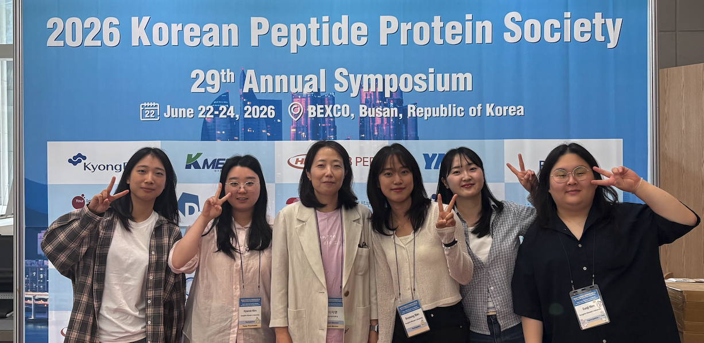
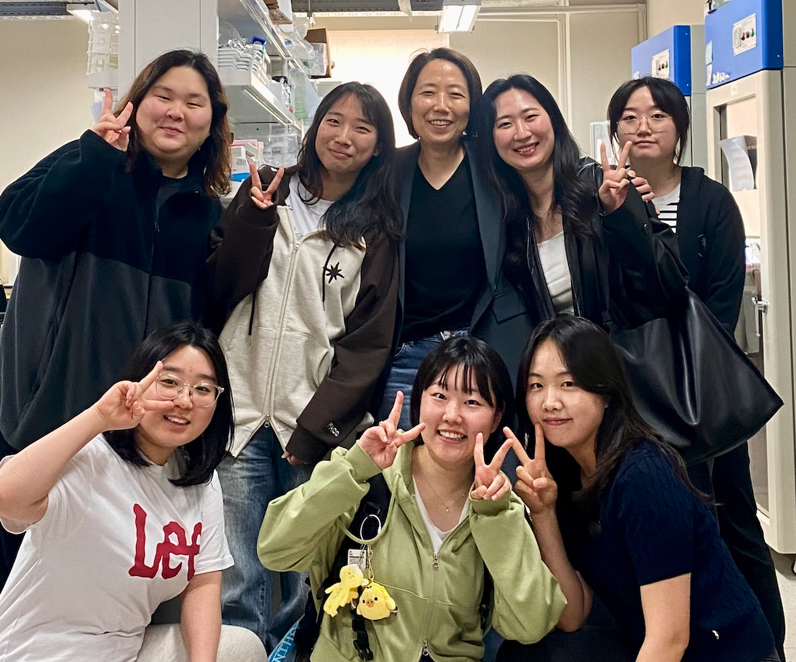
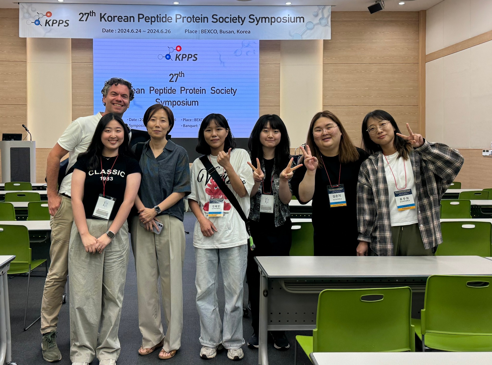
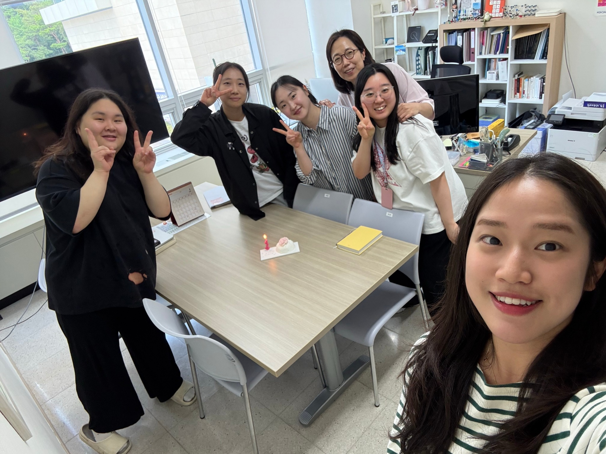
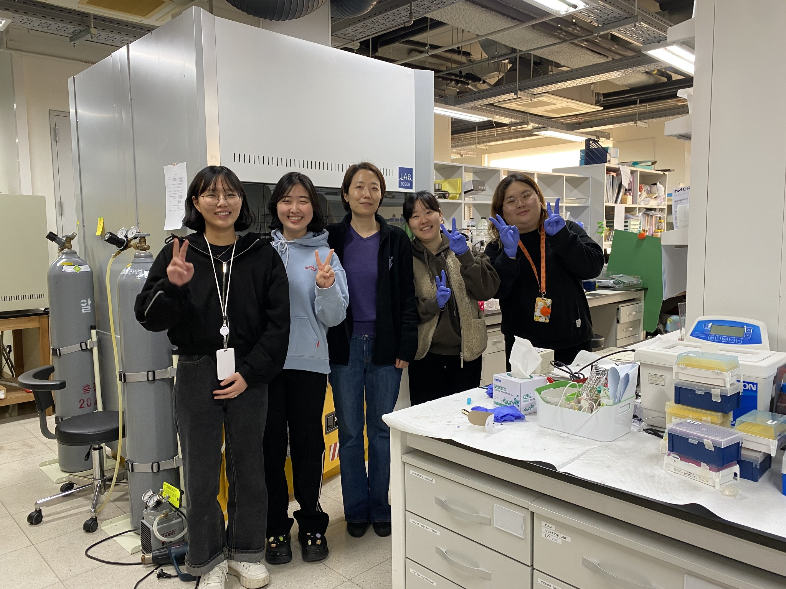

```{=html}
<div class="lab-page-intro" data-page="join"><div class="lab-intro-inner"><div><div class="lab-page-label">Join Us</div><h1>Bring your questions.<br><em>Build something new.</em></h1></div><p>Join a laboratory working at the interface of chemistry and biology. We welcome motivated students, researchers, and collaborators.</p><nav class="lab-intro-nav" aria-label="Join Us sections"><a href="#lab-life">Life in the lab</a><a href="#research-interests">Research interests</a><a href="#contact">Get in touch</a></nav></div></div>
```

```{=html}
<div id="lab-life" class="join-photos" style="display:flex;flex-wrap:wrap;align-items:flex-start;gap:12px;margin-bottom:1rem;">
  
  
  
</div>
```

We welcome motivated students and researchers interested in chemical biology, medicinal chemistry, molecular probes, drug target discovery, biomarker identification, and disease-relevant small-molecule tools.

## Research Interests

Prospective students and collaborators are encouraged to contact us if they are interested in one or more of the following areas:

- Drug target discovery and target validation
- Biomarker discovery and fluorescence-based detection
- Chemical biology and molecular probe development
- Protease biology and activity-based probes
- Peptidomimetic transporters and intracellular delivery
- AI-assisted peptide and protein binder design

## Contact

운정그린캠퍼스 A동 246a 공동연구실

Email: jlee at sungshin.ac.kr

```{=html}
<a class="lab-contact-link" href="mailto:jlee@sungshin.ac.kr">Contact the lab ↗</a>
```

```{=html}
<div class="join-photo-bottom" style="display:flex;flex-wrap:wrap;align-items:flex-start;gap:12px;margin:1.5rem 0 1rem;">
  
  
</div>
```

