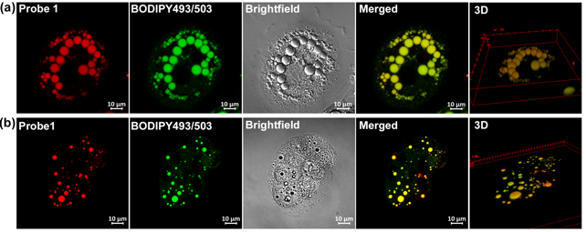

```{=html}
<style id="research-page-styles">

#quarto-content.quarto-container {display:block!important;width:100%;max-width:none;margin:0!important;padding:0!important;}
#quarto-document-content.content {display:block;width:100%;max-width:none!important;margin:0!important;padding:0!important;}
#title-block-header {display:none;}
.research-page h1,.research-page h2,.research-page h3 {padding-bottom:0;}
.research-page p {font-size:inherit;line-height:inherit;}
.research-page .thread h2,.research-page .thread h3 {color:inherit;}
.research-page .contents a {line-height:1.7;}
.research-page{--ink:#14283b;--muted:#536778;--blue:#2966c3;--teal:#147b79;--gold:#a66b18;--line:#dce5e9;--paper:#f7f9f8;color:var(--ink);font-family:Arial,Helvetica,sans-serif;font-size:16px;line-height:1.7;overflow:hidden}
.research-page *{box-sizing:border-box}.research-page a{color:inherit;text-decoration:none}.research-page a:focus-visible,.research-page summary:focus-visible{outline:3px solid #278d8d;outline-offset:5px}.research-page a:hover{text-decoration:underline;text-underline-offset:4px}.research-page h1,.research-page h2,.research-page h3,.research-page p,.research-page figure{margin:0}.research-page .wrap{width:min(1160px,calc(100% - 80px));margin:auto}.research-page .eyebrow{font-size:11px;letter-spacing:2.1px;text-transform:uppercase;font-weight:700}.research-page .muted{color:var(--muted)}
.research-page .hero{background:#102b3b;color:#fff;position:relative}.research-page .hero:before{content:'';position:absolute;inset:0;background:radial-gradient(ellipse at 84% 46%,#215b6733,transparent 60%);pointer-events:none}.research-page .hero-inner{position:relative;display:grid;grid-template-columns:1.08fr 1fr;align-items:center;gap:32px;padding:74px 0 62px}.research-page .hero .eyebrow{color:#9dc6cb;margin-bottom:25px}.research-page h1{font-family:Georgia,'Times New Roman',serif;font-weight:400;font-size:clamp(40px,4.4vw,62px);line-height:1.1;letter-spacing:-1.8px;max-width:640px;border:0!important}.research-page h1 em{color:#a4dbcf;font-weight:400}.research-page .hero-copy{font-size:17px;color:#c9d9df;max-width:510px;margin-top:25px;line-height:1.75}.research-page .hero-art{min-width:0}.research-page .hero-art svg{width:100%;height:auto;display:block}.research-page .hero-art figcaption{font-size:10px;letter-spacing:.7px;color:#8eafb9;text-align:center;margin-top:5px}.research-page .hero-bottom{display:flex;gap:26px;align-items:center;border-top:1px solid #ffffff25;padding:18px 0;font-size:11px;letter-spacing:.8px;color:#a9c3cd}.research-page .hero-bottom b{color:#edf4f5;font-weight:500}
.research-page .contents{background:#fff;border-bottom:1px solid var(--line)}.research-page .contents .wrap{display:grid;grid-template-columns:repeat(3,1fr)}.research-page .contents a{display:flex;align-items:center;gap:14px;padding:24px 20px 24px 0;font-size:13px;font-weight:600}.research-page .contents a+a{border-left:1px solid var(--line);padding-left:28px}.research-page .num{font-size:12px;color:#7c919e;font-family:monospace;font-weight:400}.research-page .contents .arrow{margin-left:auto;color:#7c919e;font-size:19px}
.research-page .intro{padding:64px 0 48px;display:grid;grid-template-columns:1fr 1.65fr;gap:75px}.research-page .intro h2{font-size:12px;letter-spacing:1.7px;text-transform:uppercase;margin-top:5px;border:0}.research-page .intro p{font-family:Georgia,serif;font-size:25px;line-height:1.5;color:#344e5e;max-width:690px}
.research-page .area{padding:56px 0 66px;border-top:1px solid var(--line);scroll-margin-top:80px}.research-page .area-head{display:grid;grid-template-columns:1.15fr 1fr;gap:62px;align-items:start}.research-page .area-kicker{display:flex;align-items:center;gap:14px;color:var(--blue);font-size:11px;font-weight:700;letter-spacing:1.65px;text-transform:uppercase;margin-bottom:18px}.research-page .area-kicker:before{content:'';width:26px;height:2px;background:currentColor}.research-page .area h2{font-family:Georgia,serif;font-size:37px;font-weight:400;line-height:1.2;letter-spacing:-.7px;border:0;margin-bottom:20px}.research-page .description{font-size:15px;color:var(--muted);line-height:1.8;max-width:580px}.research-page .tags{display:flex;flex-wrap:wrap;gap:8px;margin-top:22px}.research-page .tags span{font-size:10px;letter-spacing:.5px;border:1px solid var(--line);padding:4px 10px;border-radius:2px;background:#fff}.research-page .schematic{background:#eef4f6;border-radius:4px;overflow:hidden}.research-page .schematic svg{display:block;width:100%;height:auto}.research-page .schematic figcaption{font-size:10px;color:#5a7180;padding:0 20px 14px;line-height:1.5}.research-page .work-label{display:flex;align-items:center;gap:20px;font-size:10px;font-weight:700;letter-spacing:1.7px;text-transform:uppercase;margin:36px 0 7px;color:#6e8390}.research-page .work-label:after{content:'';height:1px;background:var(--line);flex:1}.research-page .papers{display:grid;grid-template-columns:repeat(3,1fr);gap:24px}.research-page .paper{padding:18px 0 0}.research-page .paper .meta{font-size:11px;color:#6b7f8c;margin-bottom:8px;display:flex;gap:10px;align-items:center}.research-page .paper .type{font-size:9px;border:1px solid #cfdbdf;padding:1px 6px;letter-spacing:.5px;text-transform:uppercase}.research-page .paper h3{font-size:14px;line-height:1.5;font-weight:600;min-height:43px;border:0}.research-page .paper p{font-size:12px;color:var(--muted);line-height:1.7;margin:10px 0}.research-page .paper .citation{font-size:11px;color:#526b7b}.research-page .paper .doi{display:inline-block;font-size:10px;color:var(--blue);margin-top:10px;letter-spacing:.3px}.research-page .paper .authors{font-size:10px;color:#788b97;margin-top:5px}.research-page .imaging{background:#f4f8f6}.research-page .imaging .area-kicker{color:var(--teal)}.research-page .imaging .area{border-top:0}.research-page .micrograph{background:#071112;padding:18px 18px 12px;color:#d6e3e1;box-shadow:0 10px 35px #1c493615}.research-page .micrograph img{display:block;width:100%;height:auto}.research-page .micrograph figcaption{font-size:10px;line-height:1.6;color:#9cb6af;padding-top:12px}.research-page .micrograph a{color:#b5dbd0}.research-page .delivery .area-kicker{color:var(--gold)}.research-page .delivery .schematic{background:#f8f4ec}
.research-page .feature{margin-top:38px;border:1px solid #d9e4df;background:#f8faf7;display:grid;grid-template-columns:110px 1fr;padding:24px;gap:25px;align-items:start}.research-page .feature .year{font-family:Georgia,serif;font-size:38px;line-height:1;color:var(--teal);margin:5px 0 9px}.research-page .feature .new{font-size:9px;letter-spacing:1.3px;color:#567d72;text-transform:uppercase}.research-page .feature h3{font-family:Georgia,serif;font-size:23px;font-weight:400;line-height:1.35;margin-bottom:9px}.research-page .feature p{font-size:13px;color:var(--muted);line-height:1.8}.research-page .feature .link{display:inline-block;font-size:11px;font-weight:600;color:var(--teal);margin-top:11px}.research-page .feature .journal{font-size:11px;color:#708578;margin-top:8px}
.research-page .thread{background:#102b3b;color:#fff;padding:56px 0 60px}.research-page .thread-top{display:flex;justify-content:space-between;gap:24px;align-items:end;margin-bottom:38px}.research-page .thread .eyebrow{color:#a5c8c8;margin-bottom:12px}.research-page .thread h2{font-family:Georgia,serif;font-weight:400;font-size:33px;line-height:1.3;border:0}.research-page .thread-top>a{font-size:12px;color:#bbdadb;white-space:nowrap}.research-page .timeline{display:grid;grid-template-columns:repeat(4,1fr);gap:30px}.research-page .moment{border-top:1px solid #527179;position:relative;padding-top:20px}.research-page .moment:before{content:'';position:absolute;width:7px;height:7px;border-radius:50%;background:#a6d7c9;left:0;top:-4px}.research-page .moment .date{font-size:12px;color:#8eb6bd;font-family:monospace;margin-bottom:11px}.research-page .moment h3{font-size:14px;line-height:1.5;font-weight:500;margin-bottom:9px}.research-page .moment p{font-size:12px;line-height:1.7;color:#b0c5cb}.research-page .moment a{font-size:11px;color:#dcebe6;display:inline-block;margin-top:12px}
.research-page .closing{padding:55px 0 58px;display:flex;justify-content:space-between;gap:35px;align-items:center}.research-page .closing h2{font-family:Georgia,serif;font-size:28px;font-weight:400;border:0;margin-bottom:10px}.research-page .closing p{font-size:13px;color:var(--muted);max-width:640px}.research-page .button{display:inline-block;border:1px solid #b7cbd0;padding:12px 20px;font-size:12px;font-weight:600;white-space:nowrap}.research-page .source-note{border-top:1px solid var(--line);padding:18px 0 28px;font-size:10px;color:#7b8c95}.research-page .source-note a{border-bottom:1px solid #c8d7da}
@media(max-width:900px){.research-page .wrap{width:calc(100% - 48px)}.research-page .hero-inner{gap:10px;padding:55px 0 40px}.research-page .hero-copy{font-size:15px}.research-page h1{font-size:45px}.research-page .area-head{gap:30px}.research-page .intro{gap:35px}.research-page .area h2{font-size:31px}.research-page .paper h3{min-height:0}.research-page .timeline{gap:20px}}
@media(max-width:640px){.research-page .wrap{width:calc(100% - 36px)}.research-page .hero-inner{grid-template-columns:1fr;padding:43px 0 25px;gap:18px}.research-page h1{font-size:40px;letter-spacing:-1.3px}.research-page h1 br{display:none}.research-page .hero-copy{margin-top:20px;font-size:15px}.research-page .hero-art{max-width:390px;width:100%;margin:0 auto}.research-page .hero-bottom{gap:12px;flex-wrap:wrap;font-size:10px;padding:15px 0}.research-page .contents a{font-size:10px;padding:16px 8px 16px 0;gap:7px}.research-page .contents a+a{padding-left:10px}.research-page .contents .arrow{display:none}.research-page .intro{grid-template-columns:1fr;gap:15px;padding:36px 0}.research-page .intro p{font-size:22px}.research-page .area{padding:38px 0 42px}.research-page .area-head{grid-template-columns:1fr;gap:25px}.research-page .area h2{font-size:31px}.research-page .papers{grid-template-columns:1fr;gap:0}.research-page .paper{padding:17px 0;border-bottom:1px solid var(--line)}.research-page .paper:last-child{border:0}.research-page .paper p{margin:6px 0}.research-page .work-label{margin-top:25px}.research-page .feature{grid-template-columns:1fr;gap:12px;padding:20px}.research-page .feature .year{font-size:30px;display:inline;margin-right:12px}.research-page .feature h3{font-size:22px}.research-page .thread-top{display:block}.research-page .thread-top>a{display:inline-block;margin-top:20px}.research-page .timeline{grid-template-columns:1fr 1fr;gap:30px 22px}.research-page .thread{padding:38px 0}.research-page .thread h2{font-size:29px}.research-page .closing{display:block;padding:36px 0}.research-page .closing .button{margin-top:20px}}
@media(prefers-reduced-motion:no-preference){.research-page a{transition:color .15s}.research-page .pulse{animation:gentle 5s ease-in-out infinite}@keyframes gentle{50%{opacity:.45}}}
@media print{.research-page .hero,.research-page .thread{print-color-adjust:exact;-webkit-print-color-adjust:exact}.research-page .area,.research-page .paper{break-inside:avoid}.preview-reviewbar{position:static!important}}


/* Compact Research opening section. */
.research-page .hero-inner{padding:34px 0 27px;grid-template-columns:1.15fr .85fr;gap:35px;}
.research-page .hero h1{font-size:clamp(40px,4vw,56px);}
.research-page .hero-copy{font-size:16px;margin-top:20px;}
.research-page .hero-art{width:100%;max-width:360px;margin-left:auto;}
.research-page .hero-bottom{padding:13px 0;}
@media(max-width:900px){.research-page .hero-inner{padding:30px 0 25px;gap:20px}.research-page .hero h1{font-size:43px}.research-page .hero-art{max-width:310px}}
@media(max-width:640px){.research-page .hero-inner{grid-template-columns:1fr;padding:28px 0 20px;gap:13px}.research-page .hero h1{font-size:39px}.research-page .hero-copy{font-size:14px;margin-top:17px}.research-page .hero-art{max-width:250px;margin:0 auto}.research-page .hero-bottom{padding:12px 0}}


/* Experimental imagery in place of the former conceptual hero illustration. */
.research-page .hero-art.research-evidence{background:#071214;border:1px solid #52717a;padding:12px 12px 14px;width:100%;max-width:490px;margin-left:auto;box-shadow:0 16px 36px #020e1622}
.research-page .research-evidence img{display:block;width:100%;height:auto}
.research-page .hero-art.research-evidence figcaption{text-align:left;line-height:1.9;font-size:11px;letter-spacing:.2px;margin:12px 2px 0;color:#b9d2d6}
.research-page .research-evidence figcaption span{font-size:9px;letter-spacing:1.5px;color:#a4dbcf}
.research-page .research-evidence figcaption a{display:inline-block;color:#c1e7dc;margin-top:5px;font-size:10px}
@media(max-width:640px){.research-page .hero-art.research-evidence{padding:9px 9px 11px;margin:0 auto;max-width:440px}.research-page .hero-art.research-evidence figcaption{font-size:10px;margin-top:9px}}
</style>
<div class="research-page" id="research-top">
<section class="hero"><div class="wrap"><div class="hero-inner"><div><h1>Chemical tools to <em>see</em><br> and <em>reach</em> inside cells.</h1><p class="hero-copy">We design chemical probes and peptoid transporters to read enzyme activity, visualize cellular environments, and improve intracellular cargo delivery.</p></div><figure class="hero-art research-evidence"><a href="https://doi.org/10.1039/D6RA06745J" aria-label="Read the peptoid transporter study in RSC Advances"></a><figcaption><span>PEPTOID TRANSPORTERS · LIVE-CELL IMAGING</span><br>Peptoids in green · mitochondria in red · nuclei in blue<br>Shin, Kim et al. · <em>RSC Advances</em>, 2026 · Fig. 3<br><a href="https://doi.org/10.1039/D6RA06745J">View the study ↗</a> · <a href="https://creativecommons.org/licenses/by-nc/3.0/">CC BY-NC 3.0</a></figcaption></figure></div><div class="hero-bottom"><b>Drug Target and Biomarker Discovery Laboratory</b></div></div></section>
<nav class="contents" aria-label="Research areas"><div class="wrap"><a href="#protease"><span class="num">01</span>Protease activity<span class="arrow">↘</span></a><a href="#imaging"><span class="num">02</span>Fluorescent imaging<span class="arrow">↘</span></a><a href="#delivery"><span class="num">03</span>Intracellular delivery<span class="arrow">↘</span></a></div></nav>
<div class="wrap"><section class="intro"><h2>Our approach</h2><p>We connect molecular design with measurements in living systems—asking how a molecule’s structure controls what it detects, where it goes, and how it interacts with cells.</p></section>
<section class="area" id="protease"><div class="area-head"><div><div class="area-kicker">01 / Protease activity</div><h2>Chemical readouts<br>of active enzymes.</h2><p class="description">Protease function depends on when and where an enzyme is active. We develop activity-based probes that combine molecular recognition, reactive groups, and fluorescent reporters to investigate active proteases in living cells. Our work spans asparaginyl endopeptidase (AEP) and the HTRA family, with an emphasis on probe reactivity, subtype preference, and subcellular access.</p><div class="tags"><span>Activity-based probes</span><span>AEP / legumain</span><span>HTRA1 &amp; HTRA2</span></div></div><figure class="schematic"><svg viewBox="0 0 480 270" xmlns="http://www.w3.org/2000/svg" role="img" aria-label="Conceptual modular design of an activity-based probe"><g font-family="Arial,sans-serif"><text x="26" y="34" font-size="9" fill="#6b8495" letter-spacing="1.8">A MODULAR CHEMICAL READOUT</text><path d="M88 115h110m48 0h91" stroke="#799bb1" stroke-width="3"/><circle cx="77" cy="115" r="28" fill="#70a8d9" fill-opacity=".22" stroke="#367fbb" stroke-width="2"/><circle cx="77" cy="115" r="13" fill="#387fb8"/><path d="m176 115 22-16 23 32 22-32 23 16" fill="none" stroke="#426987" stroke-width="4" stroke-linecap="round"/><path d="m345 87 39 28-39 28Z" fill="#d3ad65" stroke="#b18a45" stroke-width="1.5"/><path d="m77 148v23m144-23v23m136-23v23" stroke="#9cb1bc"/><text x="77" y="193" text-anchor="middle" font-size="12" fill="#254758">Reporter</text><text x="221" y="193" text-anchor="middle" font-size="12" fill="#254758">Recognition</text><text x="357" y="193" text-anchor="middle" font-size="12" fill="#254758">Reactive group</text><text x="77" y="211" text-anchor="middle" font-size="10" fill="#6b8495">Optical readout</text><text x="221" y="211" text-anchor="middle" font-size="10" fill="#6b8495">Target preference</text><text x="357" y="211" text-anchor="middle" font-size="10" fill="#6b8495">Activity-dependent labeling</text><path d="M28 240h424" stroke="#d4e0e5"/></g></svg><figcaption>Conceptual probe architecture. Specific reporter and recognition elements vary across studies.</figcaption></figure></div><div class="work-label">Selected research</div><div class="papers"><article class="paper"><div class="meta"><span>2017</span><span class="type">Article</span></div><h3><a href="https://doi.org/10.1039/C7OB01467H" target="_blank" rel="noopener">Turn-on detection of AEP activity</a></h3><p>A smart probe reports subcellular asparaginyl endopeptidase activity in living cells.</p><div class="citation"><i>Organic &amp; Biomolecular Chemistry</i></div><div class="authors">Hong et al.</div><a class="doi" href="https://doi.org/10.1039/C7OB01467H" target="_blank" rel="noopener">Read paper ↗</a></article><article class="paper"><div class="meta"><span>2020</span><span class="type">Article</span></div><h3><a href="https://doi.org/10.1021/acschembio.0c00279" target="_blank" rel="noopener">Activity-based probes for HTRA proteases</a></h3><p>Live-cell activity measurements include HTRA1 in an AD-like cellular model and mitochondria-targeted labeling of HTRA2.</p><div class="citation"><i>ACS Chemical Biology</i></div><div class="authors">Nam, Song, Eo et al.</div><a class="doi" href="https://doi.org/10.1021/acschembio.0c00279" target="_blank" rel="noopener">Read paper ↗</a></article><article class="paper"><div class="meta"><span>2023</span><span class="type">Article</span></div><h3><a href="https://doi.org/10.1016/j.bmcl.2023.129259" target="_blank" rel="noopener">Structure–activity relationships for HTRA probes</a></h3><p>Probe design is refined to improve reactivity and preferences among HTRA subtypes.</p><div class="citation"><i>Bioorganic &amp; Medicinal Chemistry Letters</i></div><div class="authors">Song, Lee et al.</div><a class="doi" href="https://doi.org/10.1016/j.bmcl.2023.129259" target="_blank" rel="noopener">Read paper ↗</a></article></div></section></div>
<div class="imaging"><div class="wrap"><section class="area" id="imaging"><div class="area-head"><div><div class="area-kicker">02 / Fluorescent imaging</div><h2>Turn cellular environments<br>into visible signals.</h2><p class="description">Fluorogenic molecules translate local chemistry and physical environments into optical signals. We design probes for biological thiols and lipid droplets, and study how molecular structure controls fluorescence responses. These tools support imaging from living cells to tissues; related molecular-rotor chemistry also enables latent-fingerprint visualization.</p><div class="tags"><span>Fluorogenic design</span><span>Lipid droplets</span><span>Live-cell &amp; tissue imaging</span></div></div><figure class="micrograph"><figcaption>Lipid-droplet imaging · cellular and subcellular views.<br>Related study: Kim et al., <i>Analytical Chemistry</i> (2024). <a href="https://doi.org/10.1021/acs.analchem.3c05368" target="_blank" rel="noopener">Source paper ↗</a></figcaption></figure></div><div class="work-label">Selected research</div><div class="papers"><article class="paper"><div class="meta"><span>2018</span><span class="type">Article</span></div><h3><a href="https://doi.org/10.1002/bkcs.11429" target="_blank" rel="noopener">Biothiol-responsive fluorescence</a></h3><p>A turn-on fluorescent probe enables live-cell imaging of biothiols.</p><div class="citation"><i>Bulletin of the Korean Chemical Society</i></div><div class="authors">Hong et al.</div><a class="doi" href="https://doi.org/10.1002/bkcs.11429" target="_blank" rel="noopener">Read paper ↗</a></article><article class="paper"><div class="meta"><span>2022</span><span class="type">Article</span></div><h3><a href="https://doi.org/10.1039/D2RA06728E" target="_blank" rel="noopener">Molecular rotors for latent fingerprints</a></h3><p>Sensitivity to hydrophobic and viscous environments extends fluorogenic design to forensic imaging.</p><div class="citation"><i>RSC Advances</i></div><div class="authors">Choi et al.</div><a class="doi" href="https://doi.org/10.1039/D2RA06728E" target="_blank" rel="noopener">Read paper ↗</a></article><article class="paper"><div class="meta"><span>2024</span><span class="type">Article</span></div><h3><a href="https://doi.org/10.1021/acs.analchem.3c05368" target="_blank" rel="noopener">Dynamic imaging of lipid droplets</a></h3><p>Dioxaborine barbiturate probes visualize lipid droplets in cells and fruit-fly tissues.</p><div class="citation"><i>Analytical Chemistry</i></div><div class="authors">Kim, Jeon et al.</div><a class="doi" href="https://doi.org/10.1021/acs.analchem.3c05368" target="_blank" rel="noopener">Read paper ↗</a></article></div></section></div></div>
<div class="wrap"><section class="area delivery" id="delivery"><div class="area-head"><div><div class="area-kicker">03 / Intracellular delivery</div><h2>Design transporters<br>around the cargo.</h2><p class="description">Cellular entry, subcellular localization, and toxicity respond differently to molecular design. We investigate amphipathic peptoids with tunable side chains, charge, and conformation to understand these relationships. From mitochondria-targeting sequences to protein- and nanoparticle-delivery systems, our goal is to balance useful cellular accumulation with compatibility in biological settings.</p><div class="tags"><span>Peptoids &amp; peptidomimetics</span><span>Mitochondrial targeting</span><span>Protein &amp; nanoparticle cargos</span></div></div><figure class="schematic"><svg viewBox="0 0 480 270" xmlns="http://www.w3.org/2000/svg" role="img" aria-label="Conceptual peptoid design and cargo uptake, not a proven entry mechanism"><defs><pattern id="membrane" width="18" height="60" patternUnits="userSpaceOnUse"><circle cx="9" cy="8" r="4" fill="#aabbb0"/><path d="m6 14 1 14m5-14-1 14m-5 4 1 14m5-14-1 14" stroke="#c2cec5" stroke-width="2"/><circle cx="9" cy="52" r="4" fill="#aabbb0"/></pattern></defs><g font-family="Arial,sans-serif"><text x="26" y="32" font-size="9" fill="#8a7c5f" letter-spacing="1.8">SEQUENCE · UPTAKE · LOCALIZATION</text><rect x="22" y="124" width="436" height="60" fill="url(#membrane)"/><g stroke="#b38944" fill="#d3b980" stroke-width="2"><path d="m115 74 22 13 23-13 22 13" fill="none"/><circle cx="115" cy="74" r="5"/><circle cx="137" cy="87" r="5"/><circle cx="160" cy="74" r="5"/><circle cx="182" cy="87" r="5"/></g><g stroke="#7b9d92" fill="#c6d7cb"><circle cx="304" cy="77" r="26"/><circle cx="296" cy="70" r="4"/><circle cx="315" cy="78" r="4"/><circle cx="300" cy="88" r="4"/></g><path d="m282 53-10-7m14 52-10 6m47-44 10-7m-4 41 10 6m-34-51v-9" stroke="#b38944" stroke-width="3"/><g fill="#5f735f" font-size="11"><text x="145" y="112" text-anchor="middle">Peptoid transporter</text><text x="305" y="112" text-anchor="middle">Functionalized nanoparticle</text><text x="29" y="216">Cells &amp; 3D spheroids</text><text x="29" y="235" font-size="10" fill="#8e8b79">Cellular accumulation assessed experimentally</text></g><path d="M301 190v32m-6-7 6 7 6-7" stroke="#b38944" fill="none" stroke-width="1.5" stroke-dasharray="3 3"/><circle cx="302" cy="239" r="9" fill="#c6d7cb" stroke="#7b9d92"/></svg><figcaption>Conceptual overview of transporter and nanoparticle studies. It does not specify an uptake mechanism or imply cytosolic release.</figcaption></figure></div><article class="feature"><div><div class="year">2026</div><span class="new">Recent publication</span></div><div><h3>Amphipathic peptoid transporters for protein and nanoparticle delivery</h3><p>Sequence design extends peptoid transporters to macromolecular cargos: biotinylated analogues promote streptavidin accumulation, while peptoid-functionalized PLGA nanoparticles show enhanced cellular uptake and accumulation in 3D tumor spheroids.</p><div class="journal">Shin, Kim et al. · <i>RSC Advances</i> <b>2026</b>, 16, 62698–62709</div><a class="link" href="https://doi.org/10.1039/D6RA06745J" target="_blank" rel="noopener">Explore the study ↗</a></div></article><div class="work-label">Foundations &amp; design principles</div><div class="papers"><article class="paper"><div class="meta"><span>2018</span><span class="type">Article</span></div><h3><a href="https://doi.org/10.1021/acs.bioconjchem.8b00148" target="_blank" rel="noopener">Mitochondria-targeting peptoids</a></h3><p>Amphipathic peptoid sequences combine cellular uptake with mitochondrial localization.</p><div class="citation"><i>Bioconjugate Chemistry</i></div><div class="authors">Nam, Hong et al.</div><a class="doi" href="https://doi.org/10.1021/acs.bioconjchem.8b00148" target="_blank" rel="noopener">Read paper ↗</a></article><article class="paper"><div class="meta"><span>2022</span><span class="type">Article</span></div><h3><a href="https://doi.org/10.1002/pep2.24239" target="_blank" rel="noopener">Charge and hydrophobicity in mitochondrial targeting</a></h3><p>Structure–activity studies distinguish determinants of cellular entry and mitochondrial localization.</p><div class="citation"><i>Peptide Science</i></div><div class="authors">Kim, Lee et al.</div><a class="doi" href="https://doi.org/10.1002/pep2.24239" target="_blank" rel="noopener">Read paper ↗</a></article><article class="paper"><div class="meta"><span>2026</span><span class="type">Review</span></div><h3><a href="https://doi.org/10.1039/D6OB00146G" target="_blank" rel="noopener">Design principles for cell-penetrating peptides</a></h3><p>A review connects sequence properties with cargo, biological context, and therapeutic requirements.</p><div class="citation"><i>Organic &amp; Biomolecular Chemistry</i></div><div class="authors">Kim, Lee, Ryu et al.</div><a class="doi" href="https://doi.org/10.1039/D6OB00146G" target="_blank" rel="noopener">Read paper ↗</a></article></div></section></div>
<section class="thread"><div class="wrap"><div class="thread-top"><div><div class="eyebrow">A connected research trajectory</div><h2>From molecular recognition<br>to cellular context.</h2></div><a href="publications.html" target="_blank" rel="noopener">Explore all publications ↗</a></div><div class="timeline"><article class="moment"><div class="date">2017</div><h3>Report enzyme activity</h3><p>A turn-on probe reveals subcellular AEP activity in living cells.</p><a href="https://doi.org/10.1039/C7OB01467H" target="_blank" rel="noopener">AEP probes ↗</a></article><article class="moment"><div class="date">2018–2023</div><h3>Tune molecular selectivity</h3><p>Peptoid targeting and HTRA-probe studies connect chemical structure with cellular behavior.</p><a href="https://doi.org/10.1002/pep2.24239" target="_blank" rel="noopener">Peptoid design ↗</a></article><article class="moment"><div class="date">2024</div><h3>Image dynamic environments</h3><p>Fluorogenic lipid-droplet probes extend imaging to cells and tissues.</p><a href="https://doi.org/10.1021/acs.analchem.3c05368" target="_blank" rel="noopener">Lipid-droplet imaging ↗</a></article><article class="moment"><div class="date">2026</div><h3>Expand the cargo</h3><p>Peptoid transporters are evaluated with proteins, nanoparticles, and 3D spheroid models.</p><a href="https://doi.org/10.1039/D6RA06745J" target="_blank" rel="noopener">Cargo delivery ↗</a></article></div></div></section>
<div class="wrap"><section class="closing"><div><h2>Questions that connect chemistry and cells.</h2><p>We welcome discussions on activity-based probes, fluorogenic imaging, and molecular transporters, as well as applications that bring these approaches together.</p></div><a class="button" href="join.html" target="_blank" rel="noopener">Work with us ↗</a></section><div class="source-note">Research overview based on selected publications, 2017–2026. Review articles are identified separately. <a href="publications.html" target="_blank" rel="noopener">Full publication list ↗</a></div></div></div>
```

